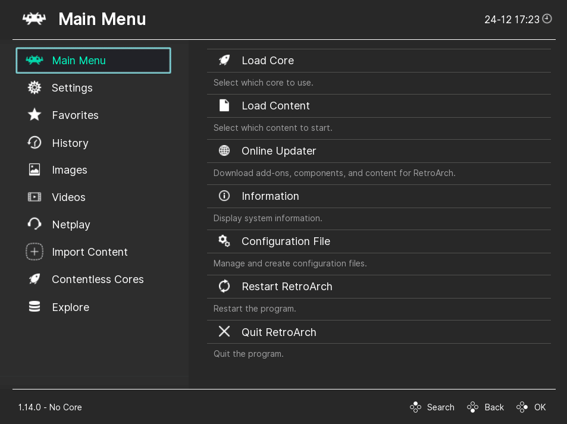

# Cores

Cores are essentially other programs and games that run through RetroArch. RetroArch requires cores to run any content.

!!! tip
    Many game console may have multiple emulator cores, the question of which one is the best may come up. Emulators can be designed to be more accurate at the cost of a performance hit, check out the Emulation General Wiki for a good look at what will suit your needs and hardware.

## Installing cores through RetroArch interface

!!! tip
    If you do not see the "Core Downloader" option, you may have installed RetroArch using a package manager. If so, see [Installing cores through package manager (Ubuntu PPA only)](#installing-cores-through-package-manager-ubuntu-ppa-only). Otherwise, to enable it:

    - Navigate to **Settings**
    - Navigate to **User Interface**
    - Navigate to **Menu Item Visibility**
    - Enable **Show Core Downloader**

- Navigate to **Online Updater**
- Navigate to **Select Core Downloader**
- Select the core you want to download

!!! note
    If you're using the Ubuntu PPA version of RetroArch and have enabled "Show Core Downloader" manually, your changes will not be reflected unless your the Cores directory setting is set to a writable location in the [Directory Configuration](change-directories.md#cores).

## Installing cores manually

When the Core Downloader is not available, or you want a specific build, a core can be installed by hand from the [buildbot](https://buildbot.libretro.com/nightly/):

1. Open the folder for your platform and architecture, then `latest/`, for example `nightly/windows/x86_64/latest/`, `nightly/linux/x86_64/latest/`, `nightly/linux/aarch64/latest/` or `nightly/apple/osx/arm64/latest/`. Android cores are in `nightly/android/latest/<abi>/`, for example `arm64-v8a`.
2. Download the core's zip, for example `snes9x_libretro.so.zip`, and extract it. The file inside is the core: `.dll` on Windows, `.so` on Linux and Android, `.dylib` on macOS.
3. Copy it into RetroArch's cores folder. Its location is shown in **Settings > Directory > Cores**; see [Directory Configuration](change-directories.md#cores).
4. Make sure RetroArch also has the core's info file. Without it the core still loads, but RetroArch does not know its name, supported extensions, firmware or which features (save states, rewind, run-ahead) it supports. Use **Online Updater > Update Core Info Files**, or download [info.zip](https://buildbot.libretro.com/assets/frontend/info.zip) and extract it into the folder shown in **Settings > Directory > Core Info**.
5. Restart RetroArch.

Instead of step 3 you can put the extracted core in the folder shown in **Settings > Directory > Downloads** and use **Load Core > Install or Restore a Core**, which copies it into the cores folder.

## Installing cores through package manager (Ubuntu PPA only)

!!! note
    Installing RetroArch through the Ubuntu PPA will disable the "Core Downloader" option in RetroArch's interface, therefore core installation needs to happen through the Ubuntu package manager.

- Open a terminal
- Start typing **sudo apt-get install libretro-**
- Press tab a few times until all available possibilities show, press space to expand the list.
- Now type the full name of the core you want to install *Example: sudo apt-get install libretro-nestopia*
- Press enter and follow the process to install
