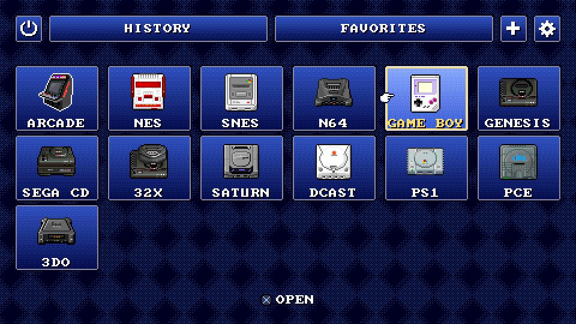
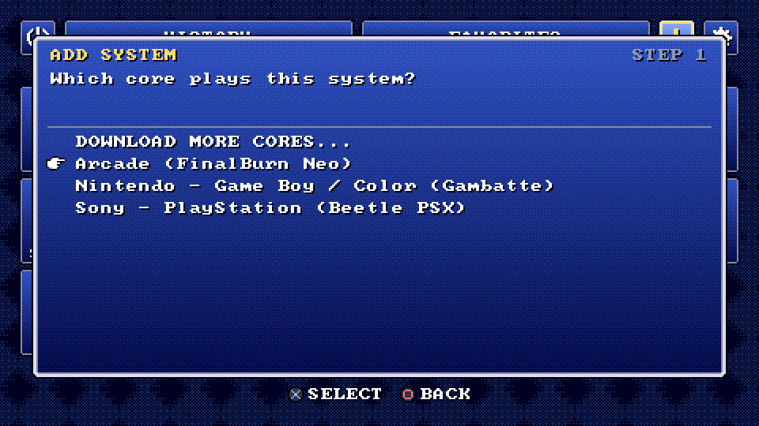
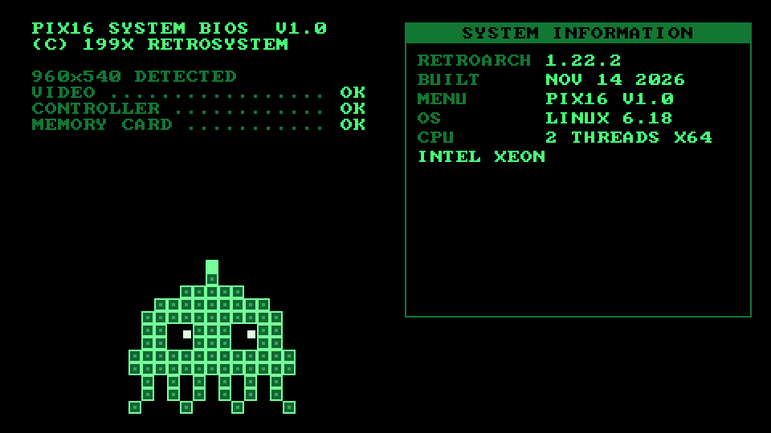
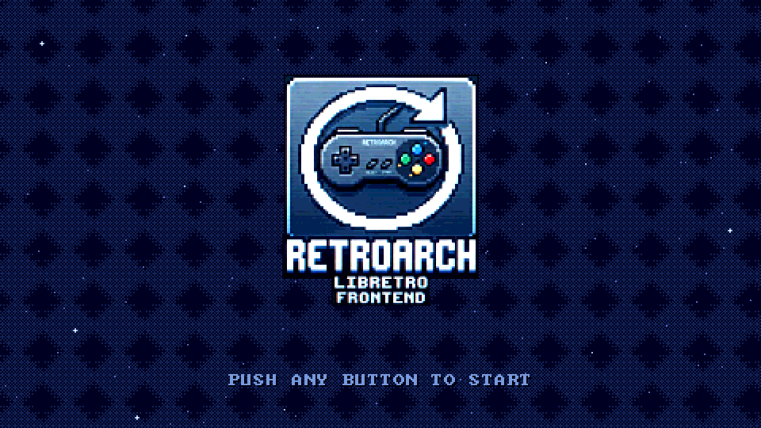

# pix16 menu driver

!!! note
    pix16 is proposed in [RetroArch pull request #20102](https://github.com/libretro/RetroArch/pull/20102) and is not in released builds yet.

pix16 is a RetroArch menu driver with the look of a 16-bit console era JRPG. It draws the whole menu into a small software framebuffer with an 8×8 pixel font, so it stays pixel exact on 15 kHz CRTs driven through CRT SwitchRes, and still scales cleanly on modern screens.

- **4:3 layout:** 320×240, the default.
- **Widescreen layout:** 480×270, for 16:9 screens.

To use it, go to **Settings › Drivers › Menu**, choose `pix16` and restart RetroArch, or set it in `retroarch.cfg`:

```
menu_driver = "pix16"
```



## How pix16 differs from RetroArch's other menus

pix16 uses RetroArch's own menus for all settings, so nothing is lost. What it changes is the way you get to your games, and the parts you see most often:

| | RGUI, Ozone, XMB, MaterialUI | pix16 |
|---|---|---|
| **Start screen** | Main Menu | The systems grid, built from your playlists |
| **Adding games** | Import Content › Scan Directory / Manual Scan, then set the core per playlist | The **+** Add System wizard does core, name, placement, scan and BIOS check in one flow |
| **Organizing systems** | One entry per playlist | Systems can be grouped: arcade sets under one ARCADE tile, add-ons inside their console's tile |
| **Starting a game** | Playlist entry › a submenu with Run, Set Core, Information… | A small window: **Run**, or **Load Save** to continue from the newest save state |
| **Pausing** | The full Quick Menu | A small pause window (Resume, Quit, Save State, Load State); **Start** opens the full Quick Menu |
| **Closing a game** | Close Content, no question asked | Quit asks "Are you sure?", then returns you to that game in its list |
| **Favorites** | Added from the entry's submenu, removed only from the Favorites list | One toggle on the game's Start menu that adds or removes; favorites are marked with a heart in every list |
| **Guides** | Varies by driver | A button guide on every screen, matching your controller (PlayStation, Nintendo or Xbox) or your keyboard |
| **Startup** | Straight to the menu | Optional BIOS-style boot screen and title screen |

## The home screen

The home screen is a grid of tiles, one per system. Tiles are 4 across in the 4:3 layout and 6 across in widescreen, 3 rows per page. Change pages with the shoulder buttons (**PAGE** in the guide).

**Order.** The ARCADE tile comes first. Next come known systems grouped by maker, consoles before handhelds, oldest first, then any other playlists in alphabetical order. Known systems get a short label (for example "SNES", "GAME BOY") and their own colors. Any other playlist still gets a tile with its name.

**Top row.** Move up from the grid to reach the buttons:

- **Power** (top left): exit RetroArch, after a confirmation.
- **HISTORY** and **FAVORITES**: RetroArch's history and favorites lists.
- **+**: the Add System wizard (see below).
- **Gear**: the options screen.

**Long names.** A name too long for its space waits a second, then scrolls to the left. The full name is also shown in the help window at the bottom.

## Grouping systems

pix16 can put several playlists behind one tile. Opening a grouped tile shows a small **picker** window listing the systems inside it. The grouping is display only: playlists stay separate files, and RetroArch's other menus still list them one by one.

**ARCADE.** When there are two or more arcade playlists, they share a single ARCADE tile. A playlist counts as arcade when:

- its name starts with FBNeo, FB Alpha, MAME, HBMAME, Capcom - CP System, Sega - Naomi, Atomiswave, Konami, Cave or Daphne;
- it is SNK - Neo Geo;
- or its name contains "Arcade".

With only one arcade playlist, it gets an ordinary tile.

**PC Engine.** When both the PC Engine (cartridge) and PC Engine CD playlists exist, they share one PC ENGINE tile with a CARTRIDGE / CD-ROM picker.

**Inside another system.** Any playlist can be placed inside another system's tile, for example Sega CD inside Mega Drive, or Famicom Disk System inside NES. Opening that tile shows a picker with the host system first, then the systems placed inside it.

- **Choosing it:** pick "INSIDE …" on the Placement step of the Add System wizard, or edit `pix16_groups.txt` (below).
- **Limits:** grouping is one level deep. A host must be a tile of its own, so it can't itself be inside another system or inside ARCADE.

### pix16_groups.txt

Placements are saved in `pix16_groups.txt` in the config folder. That's next to `retroarch.cfg`, or the folder set in **Settings › Directory › Configurations**. It's plain text, one line per playlist name (without `.lpl`), with spaces around the `=`:

```
# <playlist name> = HOME | ARCADE | <another playlist name>
Sega - Mega-CD - Sega CD = Sega - Mega Drive - Genesis
Nintendo - Family Computer Disk System = Nintendo - Nintendo Entertainment System
Atari - Lynx = HOME
My Arcade Hacks = ARCADE
```

- **HOME**: its own tile, even if the built-in rules would put it under ARCADE.
- **ARCADE**: inside the ARCADE tile.
- **Another playlist's name**: inside that system's tile.

A line in the file always wins over the built-in rules. Lines starting with `#` are ignored, names are matched without regard to case, and the file holds up to 64 entries.

## Adding a system: the Add System wizard



**+** on the home screen opens the wizard. Each step is one question. **B** goes back a step, and the last step shows a summary before anything is written.

1. **Core: "Which core plays this system?"** Installed cores are listed by name. **DOWNLOAD MORE CORES…** at the top opens RetroArch's core downloader.
2. **System: "What is the system called?"** The systems the core lists in its core info file. Picking one of these names (for example `Nintendo - Super Nintendo Entertainment System`) means the playlist matches RetroArch's databases and the Dot-Art icon. **TYPE A NAME…** lets you enter any other name.
3. **Placement: "Where should its button go?"** HOME SCREEN, INSIDE ARCADE, or INSIDE any existing system (see Grouping).
4. **Source: "Where are the games?"**
   - **SCAN A FOLDER OF GAMES** runs a scan of a folder and its subfolders.
   - **ADD ONE GAME** adds a single file.
5. **Browse.** Start at THIS COMPUTER (your drives) or START FOLDER (RetroArch's content folder).
   - Opening a folder shows its subfolders and a count of the files it holds. Choose **[ USE THIS FOLDER ]** to scan it.
   - Only files with the core's extensions are shown and scanned, plus zip and 7z archives.
   - Large folders are listed a little at a time, so the menu never freezes. **READING…** shows while a folder is being listed.
6. **Names (arcade folder scans only).** Arcade sets have short file names, so the wizard offers to use a name file (a `.dat` or `.xml` from MAME or FBNeo) for full titles. You can also keep the file names.
7. **BIOS check.** Shown only if the core needs BIOS files that are missing. It lists them with the folder to put them in. Choose **CHECK AGAIN** after copying them, or **CONTINUE ANYWAY**.
8. **Confirm: "Ready to add this system?"** A summary of the core, system, placement, folder or game, and names. Choose **ADD THIS SYSTEM**.

What happens next:

- **A folder** uses RetroArch's manual content scan, with the system name, the core and the extensions filled in. The playlist's default core is set, so games start with that core without asking. The home screen refreshes on its own when the scan finishes.
- **A single game** is added straight to the system's playlist (created if needed), with the core set.
- **The placement** is saved in `pix16_groups.txt`.

If a playlist folder isn't set (**Settings › Directory › Playlists**), the wizard says so instead of running.

## Game lists

Opening a system shows its games. In the guide, **A** is PLAY, **B** is BACK, **Start** is MORE and the shoulder buttons are PAGE.

- **PLAY** opens a small window titled with the game's name. **RUN** starts the game. **LOAD SAVE** appears only when the game has save states, and starts the game from the newest one (the slot is shown, or AUTO).
- **MORE** (Start) opens RetroArch's options for that entry: core, information, and so on. It also has the favorites toggle: **Add to Favorites**, or **Remove from Favorites** if it's already one.
- **Favorites** are marked with a heart in the game lists.

When a game started from a list is closed, you return to that game in its list rather than to RetroArch's entry submenu.

## The pause menu

Opening the menu during a game shows a small window over the game. The game stays visible behind it, dimmed. The window is titled with the game's name and has four rows:

| Row | What it does |
|---|---|
| **RESUME GAME** | Back to the game. **B** does the same. |
| **QUIT GAME** | Asks "Are you sure you want to quit?" (the cursor starts on NO), then closes the game. |
| **SAVE STATE** | Saves to the current slot and shows "STATE SAVED" for two seconds. |
| **LOAD STATE** | Loads the newest save state and resumes. The slot is shown on the right. The row is greyed out when the game has no save states. |

**Start** opens RetroArch's full Quick Menu, with shaders, core options, overrides, cheats and the rest.

On a CRT, a game often runs in a mode with fewer lines (for example 224) or a narrower width than the menu. The pause window is then drawn inside the part of the screen that mode shows. The resolution is not changed, so there's no resync when pausing.

## Options screen

The gear opens RetroArch's own menus in three tabs, with the shoulder buttons to switch:

- **MAIN**: RetroArch's main menu.
- **SETUP**: Settings.
- **NET**: Netplay.

With the JRPG theme, the contents slide sideways when you change tab.

**BACK** returns to the systems screen. While it is highlighted, an **ABOUT** panel shows:

- the RetroArch version;
- the video driver and output resolution;
- CRT SwitchRes status;
- the audio and input drivers;
- the first controller.

## Boot screen

With **Boot Screen** on, a cold start shows two screens before the menu.

**1. The BIOS screen.** The left side types out the video mode found, controller and memory card checks, and a count of your systems and games. In widescreen, a **SYSTEM INFORMATION** panel on the right also lists:

- the RetroArch version and build date;
- OS, CPU, threads and memory;
- video, display, audio and input;
- pad 1;
- the number of installed cores.

**2. The title screen.** The RetroArch logo and **PUSH ANY BUTTON TO START**.




The boot screen ends early if RetroArch needs to ask a question (such as the first-run download offer), or if a game is starting. The game count reads your playlists a little at a time, so it never holds up startup.

The first time the menu opens with no game running, pix16 opens on the systems grid rather than the main menu.

## Settings

All in **Settings › User Interface › Appearance** (shown only while pix16 is the menu driver):

| Setting | Config key | Default | What it does |
|---|---|---|---|
| Widescreen Layout | `menu_pix16_widescreen` | off | Draws the menu at 480×270 for 16:9 displays. A game's pause menu shown at 4:3 keeps the 4:3 layout. |
| Classic Theme | `menu_pix16_classic_theme` | off | Flat colored panels instead of the JRPG windows. |
| Boot Screen | `menu_pix16_boot_screen` | on | The BIOS screen and title screen at startup. |
| Button Icons | `menu_pix16_button_style` | PlayStation | Button icons in the guides: `0` PlayStation, `1` Nintendo, `2` Xbox. |

### Button icons and keyboard keys

The guides follow **where** a button is on the pad, not its name, so each style shows the correct label for that controller. They also follow **Settings › Input › Menu Controls › Swap OK/Cancel Buttons**.

| Style | Right / bottom face buttons | Shoulders | Start |
|---|---|---|---|
| PlayStation | ○ / × | L1 / R1 | START |
| Nintendo | A / B | L / R | START |
| Xbox | B / A | LB / RB | MENU |

When no controller is connected, the guides show the menu's keyboard keys instead: **Enter** (OK), **Backspace** (back), **Page Up / Page Down** (tabs and pages) and **Space** (Start). In the 4:3 layout they are shortened to ENTR, BK, PGU / PGD and SPC. If a guide is still too wide for the screen, its last items are left out.

## Files and assets

| File | Location | Notes |
|---|---|---|
| System icons | `assets/xmb/dot-art/png/<playlist name>.png` | The XMB Dot-Art icons from retroarch-assets, shrunk at load time to fit the 64×40 tile. A playlist named after a database (for example `Nintendo - Super Nintendo Entertainment System`) has an icon already. |
| Title logo | `assets/pix16/boot_logo.png` | Optional. Without it the title screen shows the name in large text. |
| Menu sounds | `assets/sounds/` | RetroArch's standard menu sounds, turned on in **Settings › Audio › Menu Sounds**. |
| System placements | `pix16_groups.txt` in the config folder | See Grouping systems. |

pix16 doesn't need icons of its own. A new system gets one when its PNG is added to `xmb/dot-art/png/` in retroarch-assets, named exactly like the playlist. A system with no icon still gets a tile showing its name.

## Questions about the new systems

### Systems grid and grouping

**I already have playlists. Do I need to add them again?**
No. Every playlist you have shows up as a tile straight away. The wizard is only for adding new ones.

**Does grouping change or merge my playlists?**
No. Grouping only decides which tiles pix16 shows. Each playlist stays its own `.lpl` file, and RetroArch's other menu drivers still list them one by one.

**How do I move a system somewhere else later?**
Edit its line in `pix16_groups.txt` (set it to `HOME`, `ARCADE` or another playlist's name), or delete the line to go back to the built-in rules. Running the wizard again for the same system name also replaces its placement. The change shows the next time the home screen is drawn.

**What happens to systems inside a tile if I delete the host playlist?**
They get tiles of their own again. The line in `pix16_groups.txt` is kept, so they move back inside if the host playlist returns.

**Why isn't my arcade playlist under ARCADE?**
ARCADE is a single tile only when there are two or more arcade playlists. With one, it gets an ordinary tile. A playlist whose name doesn't match the arcade rules can be put there with `ARCADE` in `pix16_groups.txt`.

**Can a system be inside a system that's inside another?**
No, grouping is one level deep. A host must be a tile on the home screen.

**Why does a system have no picture?**
Icons are found by playlist name in `assets/xmb/dot-art/png/`. A custom name typed in the wizard, or a renamed playlist, has no matching file, so the tile shows the name instead. Use the database name in the wizard (the list on the System step), or add a PNG with the playlist's exact name. Updating assets with the Online Updater also fills in missing icons.

### The Add System wizard

**Where does the wizard put the games?**
In a playlist named after the system, in RetroArch's playlist folder (**Settings › Directory › Playlists**). The playlist's default core is set to the core you picked, so games start with it without asking.

**Can I add more games to a system later?**
Yes. Run the wizard again with the same core and system name. A folder scan adds the new games and keeps the existing entries, and **ADD ONE GAME** adds to the same playlist.

**How is a wizard scan different from Import Content › Manual Scan?**
It is the same scan, with these settings filled in for you:

- the system name, core and file extensions;
- subfolders included;
- an existing playlist added to rather than replaced.

Your own Manual Scan settings are saved first and put back afterwards, so they aren't changed.

**Why do my arcade games have short names like `sf2.zip`?**
Arcade sets are named that way. Answer **YES** at the Names step and pick the `.dat` or `.xml` file for the romset version you have (from MAME or FBNeo) to get full titles.

**The BIOS step says files are missing. What do I do?**
Copy the listed files into the folder shown (RetroArch's system folder) and choose **CHECK AGAIN**. **CONTINUE ANYWAY** adds the system now, but some games may not start until the BIOS is there.

**A scan is already running. What happens?**
RetroArch runs one scan at a time. It tells you, and the wizard doesn't start a second one.

### Playing and pausing

**Which save does LOAD SAVE / LOAD STATE use?**
The newest one by file date, across all slots and the auto save. pix16 looks in every place RetroArch can sort states into: the state folder, per-content-folder and per-core subfolders, or next to the content.

**Can I still get to core options, shaders and cheats while playing?**
Yes. Press **Start** in the pause window to open RetroArch's full Quick Menu.

**Does SAVE STATE pick a slot?**
It saves to RetroArch's current slot, the same as the Save State hotkey. Change the slot in the full Quick Menu (Start).

**Why does the pause window look smaller on my CRT?**
The game's mode shows fewer lines or a narrower width than the menu, so the window is drawn inside the part of the screen that mode shows. pix16 doesn't switch resolution to show it, so the screen doesn't flicker or resync.

### General

**Does pix16 show box art or screenshots?**
Not yet. It doesn't load thumbnails.

**Can I use a mouse or touch screen?**
Not yet. pix16 is made for a controller or a keyboard.

**Which platforms can use it?**
Builds that use `./configure` or `Makefile.common` (Linux, Windows with MSYS2/MinGW, and others), wherever RGUI is built. Other ports, such as Android and the MSVC projects, don't turn it on yet.

## How it was built

This section is for developers working on the driver. The code is in `menu/drivers/pix16.c`, with the bitmap font in `menu/drivers/pix16_font.h`.

**Drawing.** The menu is drawn by the CPU into an RGB565 framebuffer sized for the largest layout (480×270). It is handed to the video driver through `set_texture_frame` each time it changes, so any video driver with menu texture support can show it. The layout size is a runtime value: switching Widescreen Layout takes effect on the next frame.

**Frame handover without copies.**

- **Full-width view:** its rows are contiguous in memory, so the framebuffer is passed to the video driver directly. That includes a view cropped to fewer lines for a CRT mode.
- **Narrower view:** a view that is narrower than the framebuffer is packed into a separate buffer first, because the poke interface takes no row pitch.
- **Tab slide:** the animation between option tabs trades the shown frame and a spare buffer instead of copying the frame.

**On top of RetroArch's own menus.** The systems grid is the playlists tab's list, laid out as tiles. Grouping only changes which tiles are shown, reading `pix16_groups.txt` and the built-in arcade rules. Game lists, the entry options and every setting are RetroArch's standard menu lists, drawn in pix16's windows. The pause window, the game window, the pickers and the wizard are pix16's own. They are drawn as popups over the current screen and take input before RetroArch's menu does.

**The wizard** uses RetroArch's existing pieces:

- core info for core names, systems, extensions and firmware;
- the manual content scan task, with its settings saved and restored around the call, for folder scans;
- `playlist_init` / `playlist_push` for a single game;
- the core updater for downloads.

**Never blocking the main thread.** Directory listings in the wizard use the resumable `dir_list_iter` and run under a time budget measured with `cpu_features_get_time_usec()`. The boot screen's game count does the same: it reads playlists in 16 KB slices within a 2 ms budget per frame.

**Settings.** The four settings are declared once in `settings/settings_def_pix16.h`, using the same single-source pattern as the other settings groups. From there they reach:

- the configuration passes in `configuration.c`;
- the setting descriptors in `menu/menu_setting.c`;
- the Appearance list in `menu/menu_displaylist.c`;
- the sublabel map in `menu/cbs/menu_cbs_sublabel.c`;
- the generated message-hash regions.

`Button Icons` is a dropdown (`S_UINT_EX`), with its value labels in `intl/msg_hash_us.h` and the `pix16_button_style` enum in `menu/menu_defines.h`.

**Text.** Every string on screen comes from `msg_hash` (`MSG_PIX16_*`), so the menu can be translated through the usual intl workflow.

**Building.** The driver is built when `HAVE_PIX16` is set. It is enabled and disabled together with RGUI, in `Makefile.common`, `qb/config.params.sh`, `qb/config.libs.sh` and `griffin/griffin.c`. It is plain C89, compiles as C++, and keeps every function under the 4 KiB stack limit.
