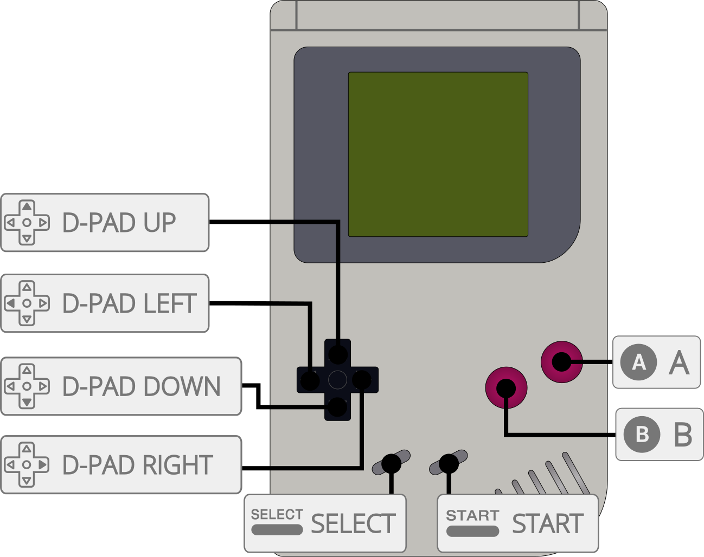
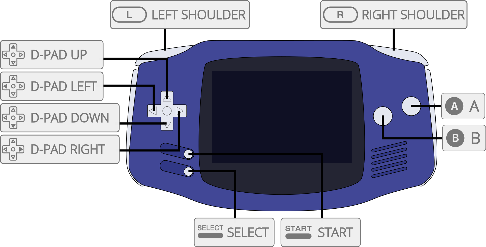
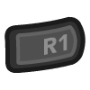

# Nintendo - Game Boy / Color / Advance (Boytacean)

## Background

Boytacean is a Game Boy (DMG), Game Boy Color (CGB) and Game Boy Advance (GBA) emulator written in Rust, with a focus on performance and safety, that can be used as a libretro core. It passes the dmg-acid2 and cgb-acid2 PPU tests, and supports the MBC1 to MBC5 cartridges, Game Genie and GameShark cheats and BESS save states for the Game Boy, and the SRAM, Flash and EEPROM saves of the Game Boy Advance cartridges.

### Author/License

The Boytacean core has been authored by

- [João Magalhães](https://github.com/joamag)

The Boytacean core is licensed under

- [Apache License 2.0](https://github.com/joamag/boytacean/blob/master/LICENSE)

A summary of the licenses behind RetroArch and its cores can be found [here](../development/licenses.md).

## Extensions

Content that can be loaded by the Boytacean core have the following file extensions:

- .gb
- .gbc
- .gba

## Databases

RetroArch database(s) that are associated with the Boytacean core:

- [Nintendo - Game Boy](https://github.com/libretro/libretro-database/blob/master/rdb/Nintendo%20-%20Game%20Boy.rdb)
- [Nintendo - Game Boy Color](https://github.com/libretro/libretro-database/blob/master/rdb/Nintendo%20-%20Game%20Boy%20Color.rdb)
- [Nintendo - Game Boy Advance](https://github.com/libretro/libretro-database/blob/master/rdb/Nintendo%20-%20Game%20Boy%20Advance.rdb)

## BIOS

The Boytacean core does not require any BIOS file: it boots the Game Boy games with the open source boot ROMs embedded in it, Bootix for the Game Boy and its own for the Game Boy Color, and emulates the BIOS calls of the Game Boy Advance games (HLE).

The Game Boy Advance BIOS is optional and, when found in the frontend's system directory, the Game Boy Advance games boot through it.

|   Filename   |    Description                   |              md5sum              |
|:------------:|:--------------------------------:|:--------------------------------:|
| gba_bios.bin | Game Boy Advance BIOS - Optional | a860e8c0b6d573d191e4ec7db1b1e4f6 |

## Features

Frontend-level settings or features that the Boytacean core respects.

| Feature           | Supported |
|-------------------|:---------:|
| Restart           | ✔         |
| Screenshots       | ✔         |
| Saves             | ✔         |
| States            | ✔ (Game Boy only) |
| Rewind            | ✔ (Game Boy only) |
| Netplay (State based) | ✔ (Game Boy only) |
| Core Options      | ✔         |
| [Memory Monitoring (achievements)](../guides/memorymonitoring.md) | ✕         |
| Cheats (Cheats menu) | ✔ (Game Boy only) |
| Native Cheats     | ✕         |
| Controls          | ✔         |
| Remapping         | ✔         |
| Multi-Mouse       | ✕         |
| Rumble            | ✕         |
| Sensors           | ✕         |
| Camera            | ✕         |
| Location          | ✕         |
| Subsystem         | ✕         |
| [Softpatching](../guides/softpatching.md) | ✔         |
| Disk Control      | ✕         |
| Username          | ✕         |
| Language          | ✕         |
| Crop Overscan     | ✕         |
| LEDs              | ✕         |

### Directories

The Boytacean core's library name is 'Boytacean'

The Boytacean core saves/loads to/from these directories.

**Frontend's Save directory**

| File  | Description            |
|:-----:|:----------------------:|
| *.srm | Cartridge save (battery backed RAM, Flash or EEPROM) |

**Frontend's State directory**

| File     | Description |
|:--------:|:-----------:|
| *.state# | State (Game Boy only) |

### Geometry and timing

- The Boytacean core's provided FPS is 59.7275
- The Boytacean core's provided sample rate is 44100 Hz for the Game Boy and 32768 Hz for the Game Boy Advance
- The Boytacean core's base size is 160x144 for the Game Boy and 240x160 for the Game Boy Advance

## Core options

The Boytacean core has the following option(s) that can be tweaked from the core options menu. The default setting is bolded.

- **DMG color palette** [palette] (**basic**|hogwards|christmas|goldsilver|pacman|mariobros|pokemon)

	Color palette used for the Game Boy (DMG) games.

## Joypad

| User 1 Remap descriptors | RetroPad Inputs                             |
|--------------------------|---------------------------------------------|
| B                        |           |
| Select                   |      |
| Start                    |       |
| Up                       |     |
| Down                     |   |
| Left                     |   |
| Right                    |  |
| A                        |           |
| L (Game Boy Advance)     |          |
| R (Game Boy Advance)     |          |

## External Links

- [Official Boytacean Website](https://boytacean.joao.me)
- [Official Boytacean Downloads](https://github.com/joamag/boytacean/releases)
- [Libretro Boytacean Core info file](https://github.com/libretro/libretro-super/blob/master/dist/info/boytacean_libretro.info)
- [Libretro Boytacean Github Repository](https://github.com/joamag/boytacean)
- [Report Libretro Boytacean Core Issues Here](https://github.com/joamag/boytacean/issues)

### See also

#### Nintendo - Game Boy (+ Color)

- [Nintendo - Game Boy / Color (Emux GB)](emux_gb.md)
- [Nintendo - Game Boy / Color (Gambatte)](gambatte.md)
- [Nintendo - Game Boy / Color (Gearboy)](gearboy.md)
- [Nintendo - Game Boy / Color (SameBoy)](sameboy.md)
- [Nintendo - Game Boy / Color (TGB Dual)](tgb_dual.md)
- [Nintendo - Game Boy Advance (mGBA)](mgba.md)
- [Nintendo - Game Boy Advance (VBA-M)](vba_m.md)
