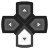
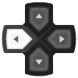

# Nintendo - Game Boy / Color (Boytacean)

## Background

Boytacean is a Game Boy (DMG) and Game Boy Color (CGB) emulator written in Rust, with a focus on performance and safety, that can be used as a libretro core. It passes the dmg-acid2 and cgb-acid2 PPU tests, and supports the MBC1 to MBC5 cartridges, Game Genie and GameShark cheats and BESS save states.

### Author/License

The Boytacean core has been authored by

- [João Magalhães](https://github.com/joamag)

The Boytacean core is licensed under

- [Apache License 2.0](https://github.com/joamag/boytacean/blob/master/LICENSE)

A summary of the licenses behind RetroArch and its cores can be found [here](../development/licenses.md).

## Extensions

Content that can be loaded by the Boytacean core have the following file extensions:

- .gb
- .gbc

## Databases

RetroArch database(s) that are associated with the Boytacean core:

- [Nintendo - Game Boy](https://github.com/libretro/libretro-database/blob/master/rdb/Nintendo%20-%20Game%20Boy.rdb)
- [Nintendo - Game Boy Color](https://github.com/libretro/libretro-database/blob/master/rdb/Nintendo%20-%20Game%20Boy%20Color.rdb)

## BIOS

The Boytacean core does not require any BIOS file: it boots the games with the open source boot ROMs embedded in it, Bootix for the Game Boy and its own for the Game Boy Color.

## Features

Frontend-level settings or features that the Boytacean core respects.

| Feature           | Supported |
|-------------------|:---------:|
| Restart           | ✔         |
| Screenshots       | ✔         |
| Saves             | ✔         |
| States            | ✔         |
| Rewind            | ✔         |
| Netplay (State based) | ✔         |
| Core Options      | ✔         |
| [Memory Monitoring (achievements)](../guides/memorymonitoring.md) | ✕         |
| Cheats (Cheats menu) | ✔         |
| Native Cheats     | ✕         |
| Controls          | ✔         |
| Remapping         | ✔         |
| Multi-Mouse       | ✕         |
| Rumble            | ✕         |
| Sensors           | ✕         |
| Camera            | ✕         |
| Location          | ✕         |
| Subsystem         | ✕         |
| [Softpatching](../guides/softpatching.md) | ✔         |
| Disk Control      | ✕         |
| Username          | ✕         |
| Language          | ✕         |
| Crop Overscan     | ✕         |
| LEDs              | ✕         |

### Directories

The Boytacean core's library name is 'Boytacean'

The Boytacean core saves/loads to/from these directories.

**Frontend's Save directory**

| File  | Description            |
|:-----:|:----------------------:|
| *.srm | Cartridge battery save |

**Frontend's State directory**

| File     | Description |
|:--------:|:-----------:|
| *.state# | State       |

### Geometry and timing

- The Boytacean core's provided FPS is 59.7275
- The Boytacean core's provided sample rate is 44100 Hz
- The Boytacean core's base size is 160x144

## Core options

The Boytacean core has the following option(s) that can be tweaked from the core options menu. The default setting is bolded.

- **DMG color palette** [palette] (**basic**|hogwards|christmas|goldsilver|pacman|mariobros|pokemon)

	Color palette used for the Game Boy (DMG) games.

## Joypad

| User 1 Remap descriptors | RetroPad Inputs                             |
|--------------------------|---------------------------------------------|
| B                        |           |
| Select                   |      |
| Start                    |       |
| Up                       |     |
| Down                     |   |
| Left                     |   |
| Right                    |  |
| A                        |           |

## External Links

- [Official Boytacean Website](https://boytacean.joao.me)
- [Official Boytacean Downloads](https://github.com/joamag/boytacean/releases)
- [Libretro Boytacean Core info file](https://github.com/libretro/libretro-super/blob/master/dist/info/boytacean_libretro.info)
- [Libretro Boytacean Github Repository](https://github.com/joamag/boytacean)
- [Report Libretro Boytacean Core Issues Here](https://github.com/joamag/boytacean/issues)

### See also

#### Nintendo - Game Boy (+ Color)

- [Nintendo - Game Boy / Color (Emux GB)](emux_gb.md)
- [Nintendo - Game Boy / Color (Gambatte)](gambatte.md)
- [Nintendo - Game Boy / Color (Gearboy)](gearboy.md)
- [Nintendo - Game Boy / Color (SameBoy)](sameboy.md)
- [Nintendo - Game Boy / Color (TGB Dual)](tgb_dual.md)
- [Nintendo - Game Boy Advance (mGBA)](mgba.md)
- [Nintendo - Game Boy Advance (VBA-M)](vba_m.md)
