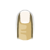

# Coolbar (CoolbarEmu)

## Background

CoolbarEmu is a Rust emulator for Coolbar/CBE applications on feature phones. CBE archives contain ARM/Thumb executable code and resources such as scenes, maps, images, audio and scripts. The core executes guest code and bridges the required firmware services.

Application variants differ in byte order, firmware interfaces and LCD dimensions. Supported content is not limited to a single handset brand or one display resolution. The [project compatibility records](https://github.com/AloysHF/CoolbarEmu/blob/master/docs/Game-Compatibility.md) describe tested variants and remaining limitations.

The CoolbarEmu core has been authored by:

- Aloys

The CoolbarEmu core is licensed under:

- [BSD-3-Clause](https://github.com/AloysHF/CoolbarEmu/blob/master/LICENSE)

A summary of the licenses behind RetroArch and its cores can be found [here](../development/licenses.md).

## BIOS

No BIOS or firmware files are required.

## Extensions

Content that can be loaded by the CoolbarEmu core has the following file extension:

- .cbe

No RetroArch content database is currently associated with this core.

## Features

Frontend-level settings or features that the CoolbarEmu core respects:

| Feature           | Supported |
|-------------------|:---------:|
| Restart           | ✔         |
| Saves             | ✕         |
| States            | ✔         |
| Rewind            | ✕         |
| Netplay           | ✕         |
| Core Options      | ✔         |
| [Memory Monitoring (achievements)](../guides/memorymonitoring.md) | ✕         |
| RetroArch Cheats  | ✕         |
| Native Cheats     | ✕         |
| Controls          | ✔         |
| Remapping         | ✔         |
| Multi-Mouse       | ✕         |
| Rumble            | ✕         |
| Sensors           | ✕         |
| Camera            | ✕         |
| Location          | ✕         |
| Subsystem         | ✕         |
| [Softpatching](../guides/softpatching.md) | ✕         |
| Disk Control      | ✕         |
| Username          | ✕         |
| Language          | ✕         |
| Crop Overscan     | ✕         |
| LEDs              | ✕         |

## Directories

The core reports the library name 'CoolbarEmu'. Its core-info display name is 'Coolbar (CoolbarEmu)', and its installed core filename is `coolbaremu_libretro.<ext>`.

## Usage

The CoolbarEmu core requires the full path to content, so content is loaded directly from disk rather than from memory.
Keep any companion resource files and directories beside the application in their original layout.

The core reports a 60 Hz frontend pacing rate and advances guest screen logic at 10 Hz. Native LCD dimensions vary by application; automatic or manually selected orientation determines the presented geometry.

Video is output in the XRGB8888 pixel format and audio is output as 44.1 kHz stereo. Save states, core options, and guest memory descriptors (system RAM and video RAM) are implemented. Guest MIDI audio is synthesized, and an auto-BGM compatibility layer can play the first packaged MIDI resource for games that never call the audio manager.

Save states use the `CBARSTAT` signature. Previous state signatures and configuration identifiers are not supported; create new states and configure the renamed core afresh.

## Core options

The CoolbarEmu core has the following option(s) that can be tweaked from the core options menu. The default setting is bolded.

- **Audio Volume (%)** (**100**|90|80|70|60|50|40|30|20|10|0)

	Master playback volume.

- **Touch/Pointer Input** (**enabled**|disabled)

	Whether mouse/touchscreen taps reach the guest.

- **CPU/HLE Debug Logging** (**disabled**|enabled)

	Forward debug-level core logs to the frontend log.

- **Auto BGM (packaged MIDI)** (**disabled**|enabled)

	Play the first packaged MIDI resource when the game never calls the audio manager.

- **Screen Orientation** (**auto**|landscape|portrait)

	Override automatic presentation orientation. Pointer coordinates follow the selected orientation.

The option keys are `coolbaremu_volume`, `coolbaremu_touch_input`, `coolbaremu_debug_logging`, `coolbaremu_auto_bgm` and `coolbaremu_screen_orientation`.

Additional per-content orientation overrides can be placed in `coolbaremu_orientation.csv` in RetroArch's system directory. Each line is `crc32,length,orientation`, with a hexadecimal CRC32, decimal byte length and `landscape` or `portrait` orientation.

## User 1 device types

The CoolbarEmu core supports the following device type(s) in the controls menu, bolded device types are the default for the specified user(s):

- **RetroPad** - Gamepad
- **Pointer** - Mouse / touchscreen

## Joypad

| RetroPad Inputs                                | User 1 input descriptors |
|------------------------------------------------|--------------------------|
|              | Confirm                  |
|              | Confirm                  |
|              | Left soft key            |
|              | Right soft key           |
|          | Confirm                  |
|         | Star (*) key             |
|             | Left soft key            |
|             | Right soft key           |
|        | Up                       |
|      | Down                     |
|      | Left                     |
|     | Right                    |

## Pointer

| RetroPointer Inputs                                                                                    | CoolbarEmu Inputs |
|-------------------------------------------------------------------------------------------------------|-----------------|
|  or  Pointer Position | Pointer X/Y     |
|  or  Pointer Pressed            | Press           |

## Compatibility

Compatibility varies by CBE runtime and application. A completed boot or captured frame does not establish full gameplay. Online authentication, multiplayer, actual payments and remote content are unavailable; see the project compatibility records for per-file interaction and rendering limitations.

## External links

- [CoolbarEmu Repository](https://github.com/AloysHF/CoolbarEmu)
- [Libretro CoolbarEmu Core info file](https://github.com/libretro/libretro-super/blob/master/dist/info/coolbaremu_libretro.info)
- [Report Libretro CoolbarEmu Core Issues Here](https://github.com/AloysHF/CoolbarEmu/issues)
